<!-- ========================================================== -->
<!--                      HERO BANNER SECTION                   -->
<!-- ========================================================== -->

  

<!-- Animated Typing Effect -->

  

<!-- Social Badges -->

  &nbsp;&nbsp;
  &nbsp;&nbsp;
  

<!-- Profile Views Counter -->

  

  

<!-- ========================================================== -->
<!--                         ABOUT ME                           -->
<!-- ========================================================== -->
## 🧑‍💻 Profile

I am a detail-driven **Full-Stack & AI Systems Engineer** specializing in engineering premium, scalable, and performant web applications paired with intelligent AI workflows. With a strong eye for design systems, modular clean architecture, and high concurrency, I build production-grade platforms using **React 19**, **Next.js 16**, **TypeScript**, and **Tailwind CSS v4**, integrating seamlessly with cloud backends like **Supabase**, **PostgreSQL**, and modern LLM APIs.

I focus on clean code, responsive layouts, sub-second latency, and fluid micro-interactions, while maintaining high performance, robust security, and technical SEO. Certified by Meta in Full-Stack & Web Engineering and Google in AI development.

 

<!-- ========================================================== -->
<!--                       FEATURED PROJECTS                    -->
<!-- ========================================================== -->
## 📁 Featured Projects

A curated selection of my strongest flagship repositories, ranked by complexity, architecture, and production readiness.

#### 🚀 [Mashhour-Hub](https://github.com/salah-khaled-dev/Mashhour-Hub-) — AI Digital Marketing Agency Platform
> **Full-scale modern AI-driven digital marketing agency platform featuring bilingual localization and high-converting service showcases.**
- **Stack:** Next.js • React • TypeScript • Tailwind CSS • Bilingual (AR/EN)
- **Highlight:** Streamlined service discovery, high-converting client CTA pipelines, and lightning-fast SSR/SSG delivery tailored for regional enterprise clients.
- **Resources:** [Live Demo](https://mashhor-hub.com/) • [Repository](https://github.com/salah-khaled-dev/Mashhour-Hub-)

#### 🌟 [AURA](https://github.com/salah-khaled-dev/aura-brand) — Enterprise Luxury Fashion Platform & ERP
> **A comprehensive, enterprise-grade luxury fashion e-commerce platform unifying a premium storefront with a full internal ERP & Admin Dashboard.**
- **Stack:** Next.js 14 • TypeScript • Tailwind CSS • Supabase (PostgreSQL) • Framer Motion • EventBus
- **Highlight:** Features a headless CMS website manager, role-based access control (RBAC), full RTL Arabic localization, real-time inventory alerts, and dynamic SEO.
- **Resources:** [Live Demo](https://aura-brand-virid.vercel.app/) • [Repository](https://github.com/salah-khaled-dev/aura-brand)

#### 🛒 [FreshCart](https://github.com/salah-khaled-dev/FreshCart-Ecommerce) — Modern Grocery & Supermarket E-Commerce
> **Modern, high-performance grocery e-commerce platform featuring interactive Swiper carousels, persistent cart drawer, and mobile navigation.**
- **Stack:** Next.js 16 • React 19 • Turbopack • Tailwind CSS v4 • shadcn/ui • Zod • React Hook Form
- **Highlight:** Built with React 19 compiler optimizations, instant client-side cart drawer with local storage sync, and mobile-first bottom app navigation.
- **Resources:** [Live Demo](https://fresh-cart-ecommerce-khaki.vercel.app/) • [Repository](https://github.com/salah-khaled-dev/FreshCart-Ecommerce)

#### 🌐 [Social App](https://github.com/salah-khaled-dev/social-app) — Real-Time Social Media Platform & Community Hub
> **Modern, high-performance social networking web application featuring JWT auth, media uploads, comments, and real-time offline detection.**
- **Stack:** React 19 • TypeScript 6 • Vite 8 • Tailwind CSS v4 • TanStack Query v5 • Axios • Zod
- **Highlight:** Dynamic posts feed with live image preview, nested comments, profile avatar customization, live unread notifications, and dual dark/light theme.
- **Resources:** [Live Demo](https://social-app-three-theta.vercel.app/) • [Repository](https://github.com/salah-khaled-dev/social-app)

#### ✨ [INFINITE BRIGHT](https://github.com/salah-khaled-dev/INFINITY-Bright-Web) — Luxury Automotive 3D WebGL Showroom
> **Ultra-premium digital experience and 3D WebGL vehicle showroom for Saudi Arabia's premier automotive protection brand.**
- **Stack:** Next.js 16 • React 19 • Three.js (React Three Fiber) • TypeScript • Tailwind CSS v4 • GSAP
- **Highlight:** Interactive 3D vehicle wrap color studio, Before & After dual-slider, instant WhatsApp concierge booking, and dual Porcelain/Obsidian luxury theme.
- **Resources:** [Live Demo](https://infinity-bright2.vercel.app/) • [Repository](https://github.com/salah-khaled-dev/INFINITY-Bright-Web)

#### 🎯 [CLASH ZONE](https://github.com/salah-khaled-dev/Clash-Zone) — Tactical Entertainment & Arena Booking System
> **Production-grade full-stack portal and booking management platform for a Laser Tag arena with real-time operational sync.**
- **Stack:** React 19 • TypeScript 6 • Vite 8 • Tailwind CSS v4 • Supabase (PostgreSQL Realtime & Auth)
- **Highlight:** Drag-and-drop weekly calendar, PostgreSQL Realtime synchronization, role-based access control (Admin/Manager/Employee), and automated WhatsApp workflows.
- **Resources:** [Live Demo](https://clash-zone-nine.vercel.app/) • [Repository](https://github.com/salah-khaled-dev/Clash-Zone)

#### ⚡ [Copra-Dashboard](https://github.com/salah-khaled-dev/Copra-Dashboard) — Cyberpunk Glassmorphic Analytics Hub
> **A premium, high-performance admin dashboard featuring a cyberpunk dark-mode glassmorphic aesthetic.**
- **Stack:** HTML5 • CSS3 (Vanilla Glassmorphism) • JavaScript (ES6) • Supabase (Auth & Database)
- **Highlight:** Fully integrated user authentication and database operations utilizing Supabase.
- **Resources:** [Live Demo](https://copra-dashboard.vercel.app) • [Repository](https://github.com/salah-khaled-dev/Copra-Dashboard)

  

<!-- ========================================================== -->
<!--                        TECH STACK                          -->
<!-- ========================================================== -->
## 🛠️ Technical Stack

I leverage a modern, curated engineering stack to architect scalable full-stack applications and intelligent AI platforms:

<table>
  <tr>
    <td width="25%"><strong>Frontend &amp; UI</strong></td>
    <td>React 19, Next.js 16 (App Router), TypeScript, Tailwind CSS v4, Three.js (WebGL), Framer Motion, GSAP</td>
  </tr>
  <tr>
    <td width="25%"><strong>Backend &amp; Cloud</strong></td>
    <td>Supabase (PostgreSQL Realtime, Auth, Storage), Node.js, Express, REST APIs, Edge Functions</td>
  </tr>
  <tr>
    <td width="25%"><strong>State &amp; Data</strong></td>
    <td>TanStack React Query v5, Zustand, EventBus Architecture, Zod Validation, Axios Interceptors</td>
  </tr>
  <tr>
    <td width="25%"><strong>AI &amp; Automation</strong></td>
    <td>LLM API Integration, Agentic AI Workflows, Prompt Engineering, Gemini / OpenAI SDKs</td>
  </tr>
  <tr>
    <td width="25%"><strong>Tooling &amp; DevOps</strong></td>
    <td>Git, GitHub Actions, Turbopack, Vite 8, Vercel CI/CD, VS Code, Figma</td>
  </tr>
</table>

 

<!-- ========================================================== -->
<!--                     CREDENTIALS / CERTS                    -->
<!-- ========================================================== -->
## 🏆 Certifications

- 🏷️ **Meta Certified Full-Stack & Web Developer**
- 🏷️ **Google AI Essentials Certified**
- 🏷️ **Gemini Student Ambassador / Certified AI Specialist**

  

<!-- ========================================================== -->
<!--                      CURRENT FOCUS                         -->
<!-- ========================================================== -->
## 🎯 Current Focus

- 🚀 **Currently Building:** High-concurrency enterprise e-commerce systems, 3D WebGL web experiences, and autonomous AI agents.
- 📚 **Currently Deepening:** React 19 Server Components, Edge Compute runtimes, and Agentic AI Architecture.
- 🌐 **Collaboration Goals:** Open to high-impact Senior Full-Stack & AI Engineering roles and scalable client platforms.

  

<!-- ========================================================== -->
<!--                     GITHUB ANALYTICS                       -->
<!-- ========================================================== -->
## 📊 GitHub Analytics

These live trackers automatically monitor my active repositories and coding cadence.

  
  

  

 

<!-- ========================================================== -->
<!--                     SNAKE CONTRIBUTION                     -->
<!-- ========================================================== -->
## 🐍 Contribution Activity

<picture>
  <source media="(prefers-color-scheme: dark)" srcset="https://raw.githubusercontent.com/salah-khaled-dev/salah-khaled-dev/output/github-contribution-grid-snake-neon.svg" />
  <source media="(prefers-color-scheme: light)" srcset="https://raw.githubusercontent.com/salah-khaled-dev/salah-khaled-dev/output/github-contribution-grid-snake.svg" />
  
</picture>

  

<!-- ========================================================== -->
<!--                        FOOTER BRANDING                     -->
<!-- ========================================================== -->

  

